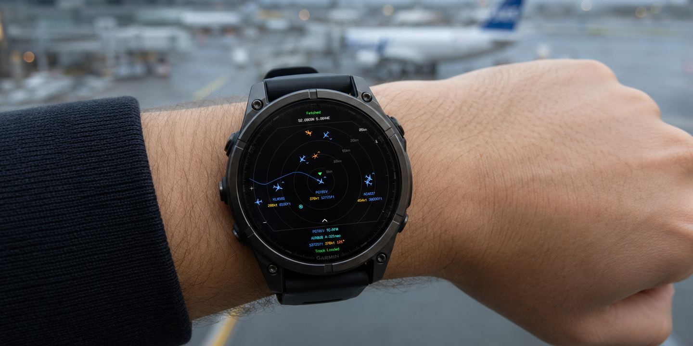
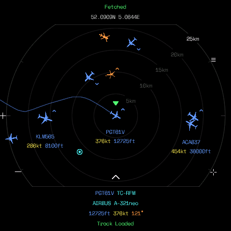
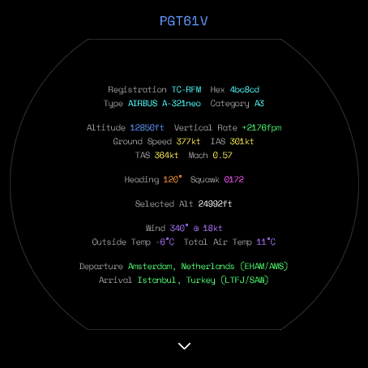

# Flight Radar

A live ADS-B flight radar for Garmin watches, showing every aircraft around you plotted in real time on a radar-style display centered on your GPS position, with a tap for full flight detail.

---

## Features

- Live ADS-B aircraft positions plotted in real time on a radar-style circular display, centered on your GPS position
- Smooth motion between polls: each aircraft is dead-reckoned from its last reported speed and track
- **4 zoom levels** (5 / 10 / 25 / 50 km) with an adaptive poll interval, closer zoom polls faster, wider zoom polls slower
- **83 aircraft silhouette icons** (from the tar1090 icon set), matched by exact aircraft type where possible and rotated to true heading
- Color-coded by category at a glance: light aircraft, heavy jets, high-speed/military types, and helicopters each get their own color
- **Tap to select** any aircraft for a live historical flight track, a compact detail panel, and climb/descend chevrons
- **Swipe up** on a selected aircraft for a full-screen detail view: registration, type, category, operator, altitude, vertical rate, ground/indicated/true airspeed, Mach, heading, squawk, IDENT/ALERT status, autopilot-selected altitude/heading, wind, outside/total air temperature, and departure/arrival airports
- Emergency warning badge (7500 / 7600 / 7700 squawk or the feed's own emergency flag), drawn ahead of everything else
- Nearby airport markers labeled with their IATA code (ICAO for small airfields)
- Optional OSM background map (MapTiler raster tiles, selectable style, dark variant by default), fetched incrementally per-tile and cached _(off by default, the biggest network/battery cost in the app)_
- Range rings, compass ticks, and a lat/lon grid overlay, all independently toggleable
- Ground-vehicle and fixed-obstacle (towers, masts, tethered balloons) filtering, grounded/stale-position dimming, military filtering
- Battery Saver mode (triples the poll interval, halves the redraw rate, turns off smooth motion) and Single Color Mode (uniform aircraft color, no category coding)
- Metric/imperial unit toggle throughout
- Pan by dragging, recenter/deselect/exit via Back

---

## Layout

### Radar view

- **Top**: fetch status (`Waiting for GPS...` / `Live` / `Fetching...` / `No Signal <code>` / `Too Busy`) and your current coordinates
- Optional OSM background map behind everything, tiles load in as you pan/zoom with a "Loading..." placeholder for tiles not yet cached; on a zoom change the previous tiles stay visible, scaled, until the new ones arrive
- Nearby airports are azure dots with their IATA code; small airfields without one are smaller, dimmer and labeled by ICAO code
- Range rings sit at round-number distances; the outer boundary ring is labeled with the current zoom radius
- Your position is a cyan ring; an edge arrow points toward it instead if you've panned it out of view
- Aircraft are drawn as rotated silhouette icons tinted by category, with an optional callsign/speed/altitude label
- A selected aircraft gets a green reticle above it, its historical track drawn behind it, and a compact detail panel along the bottom
- Corner glyphs hint what Up / Down / Start / Back do at a glance (toggleable)

### Full detail view

Swipe up on the compact panel (or tap it) for everything the compact panel leaves out: registration, hex code, type, category, operator, altitude, vertical rate, ground/indicated/true airspeed, Mach, heading, squawk, IDENT/ALERT status, autopilot-selected altitude/heading, wind, outside/total air temperature, and departure/arrival airports resolved from the flight's callsign.

---

## Controls

| Input                                 | Action                                                              |
| ------------------------------------- | ------------------------------------------------------------------- |
| Up                                    | Zoom in                                                             |
| Down                                  | Zoom out                                                            |
| Start                                 | Select the aircraft nearest the center; with one selected, open full detail |
| Hold Up                               | Open Settings                                                       |
| Back                                  | Recenter (if panned) → deselect (if an aircraft is selected) → `Press again to exit`, a second Back within 2 s exits |
| Tap an aircraft                       | Select it: track, compact panel, chevrons                           |
| Tap empty space                       | Deselect, keep the current view                                     |
| Tap the compact panel                 | Open full detail                                                    |
| Drag                                  | Pan the map                                                         |
| Swipe up _(aircraft selected)_        | Open full detail                                                    |
| Swipe down / Back _(full detail open)_ | Close                                                               |
| Tap the bottom band _(full detail open)_ | Close                                                             |
| Drag / Up / Down _(full detail open)_ | Scroll                                                              |

---

## Settings

Reached via the on-device menu (hold Up).

### Display

| Setting                   | Description                                                            |
| ------------------------- | ---------------------------------------------------------------------- |
| Radar → Range Rings       | Distance rings and compass ticks                                       |
| Radar → Grid Lines        | Lat/lon grid overlay                                                   |
| Map → Background Map      | OSM raster map behind the radar display _(off by default)_             |
| Map → Map Style           | MapTiler style for the background map                                  |
| Map → Map Dark Mode       | Use the style's dark variant                                           |
| Airports → Airports       | Nearby airport markers                                                 |
| Airports → Small Airports | Also show ICAO-coded airfields that have no IATA code                   |
| Button Hints              | Edge glyphs showing what Up / Down / Start / Back do                   |

### Filters

| Setting              | Description                                                              |
| -------------------- | ------------------------------------------------------------------------ |
| Show Ground Vehicles | Airport service/emergency vehicles _(off by default)_                    |
| Hide Grounded Planes | Hide aircraft currently on the ground                                    |
| Hide Obstacles       | Hide fixed obstacles: towers, masts, tethered balloons _(on by default)_ |
| Hide Military        | Hide aircraft flagged as military                                        |

### Aircraft

| Setting                          | Description                                                     |
| -------------------------------- | --------------------------------------------------------------- |
| Overlays → Show Track            | Draw the selected aircraft's historical flight path             |
| Overlays → Climb/Descend Arrows  | Vertical-rate chevrons above/below climbing/descending aircraft |
| Coloring → Dim Grounded Aircraft | Dim aircraft currently on the ground                            |
| Coloring → Dim Stale Aircraft    | Dim aircraft whose position hasn't updated recently             |
| Coloring → Single Color Mode     | Draw every aircraft in the default color, ignoring category     |
| Labels → Show Labels             | Master toggle for all aircraft labels                           |
| Labels → Fields                  | Callsign, speed and altitude, each toggled individually         |

### General

| Setting       | Description                                   |
| ------------- | --------------------------------------------- |
| Metric Units  | km/h, meters, m/min instead of kt/ft/fpm      |
| Battery Saver | Triples the poll interval at every zoom level, halves the redraw rate and turns off smooth motion |

### API Status

Read-only: the last known ok/failed state of each network source (aircraft feed, background map, nearby airports, route lookup, airport info, track history). A failed aircraft feed also shows its error code.

---

## Aircraft Icons & Colors

83 aircraft silhouettes drawn from the tar1090 icon set, matched to the aircraft's exact reported type (e.g. Boeing 738, Airbus A320, F-16) where possible, falling back to a broad ADS-B category shape otherwise. Icons rotate to the aircraft's true heading, except balloons and the fixed-tower obstacle icon, which have no meaningful heading.

| Color   | Meaning                                 |
| ------- | --------------------------------------- |
| White   | Default                                 |
| Yellow  | Light aircraft                          |
| Blue    | Heavy aircraft                          |
| Purple  | High-speed aircraft                     |
| Orange  | Helicopter                              |
| Magenta | Military _(any type)_                   |
| Rose    | Ground vehicles and fixed obstacles     |
| Green   | Currently selected                      |
| Red     | Emergency _(7500 / 7600 / 7700 or flagged by the feed)_ |

---

## Data Sources

| Source                                         | Used for                                                                                                                  |
| ---------------------------------------------- | ------------------------------------------------------------------------------------------------------------------------- |
| [adsb.fi](https://adsb.fi)                     | Live aircraft positions within your zoom radius, polled continuously while the app is open, never while the screen is off |
| [OpenSky Network](https://opensky-network.org) | Historical flight track for the selected aircraft, fetched once on selection, then grown live                             |
| VRS standing data (`adsb.lol`)                 | Scheduled departure/arrival route for the selected aircraft's callsign                                                    |
| [airport-data.com](https://airport-data.com)   | City/country/IATA lookup for the resolved departure/arrival airports                                                      |
| [MapTiler](https://www.maptiler.com)           | OSM raster background map tiles, fetched on demand as you pan/zoom _(off by default)_                                     |
| [OpenAIP](https://www.openaip.net)             | Nearby airport markers, fetched as you pan/zoom                                                                           |

All sources are free. OpenSky (OAuth client credentials), MapTiler and OpenAIP (API keys) need a free account; their credentials go in the gitignored `resources/jsonData/credentials.json` under `OpenSky` (`clientId`, `clientSecret`), `MapTiler` (`apiKey`) and `OpenAIP` (`apiKey`), and are bundled at build time. Route and airport-info lookups only fire when the full detail view is opened, never during regular polling.

---

## Devices

Currently built for a single device:

- Garmin fēnix 8 47mm / 51mm / tactix 8 / quatix 8 (`fenix847mm`)
